# RemoteInspector - Unity 远程调试工具

## 📁 项目结构

```
RemoteInspector\
├── Runtime\                         # 运行时代码（打入游戏包）
│   ├── Core\                        # 客户端核心
│   │   ├── RemoteInspectorClient.cs     # TCP客户端
│   │   ├── CommandConsole.cs            # 聊天命令窗口（`或F12打开）
│   │   └── MessageHandler.cs           # 消息处理器
│   ├── Collectors\                   # 数据采集器
│   │   ├── NodeTreeCollector.cs         # GameObject树采集
│   │   ├── ComponentCollector.cs        # 组件信息采集（反射）
│   │   ├── MaterialCollector.cs        # 材质/Shader采集
│   │   └── FrameStatsCollector.cs      # FPS采集
│   └── Utils\                        # 工具类
│       ├── TextureCache.cs             # 纹理缓存
│       └── SerializationHelper.cs      # 序列化辅助
└── Shared\                          # 共享代码
    ├── Protocol\                    # 协议定义
    │   ├── MessageProtocol.cs           # TCP协议常量
    │   └── MessageSerializer.cs         # JSON序列化
    └── Commands\                     # 命令枚举
        └── CommandDefinitions.cs         # 所有命令ID定义
```


## 1. 工具路径

运行程序：

```text
RemoteInspector.exe
```

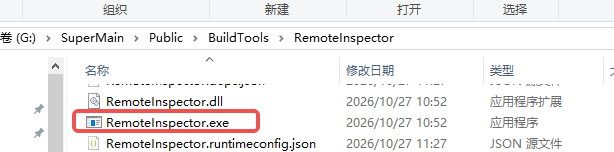

## 2. 启动工具并开启监听

双击 `RemoteInspector.exe` 启动工具，默认监听端口为 `9555`。点击“启动监听”。

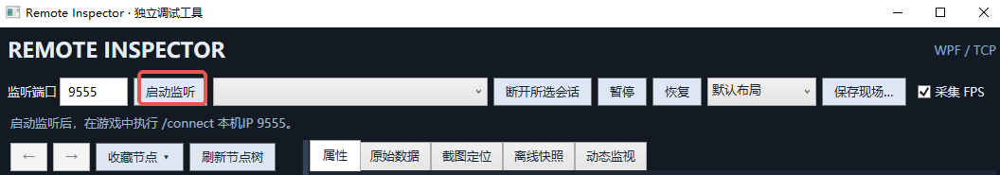

## 3. 在游戏中连接查看器

可通过以下方式连接：

1. 点击 GM 面板中的“远程 Inspector”快捷按钮。原文说明该按钮默认连接作者的 IP，使用时需确认目标地址。
2. 在聊天框输入 `..inspector,ip`，其中 `ip` 替换为运行查看器的电脑 IP。

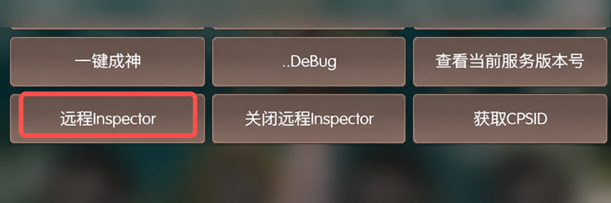

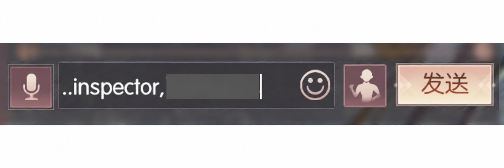


## 4. 场景节点树

1. 游戏中弹出连接提示，表示连接成功。
2. 连接后自动刷新场景节点树。
3. 节点激活状态分为“已激活”“自身未激活”“父级未激活”。
4. 支持模糊查找、组件名称查找和节点名称查找。
5. 支持收藏节点，方便下次直接定位。
6. 关闭搜索后保留历史搜索定位，避免重新查找。
7. 支持按路径定位节点，例如输入 `UIRoot/BG/Leve` 直接定位。

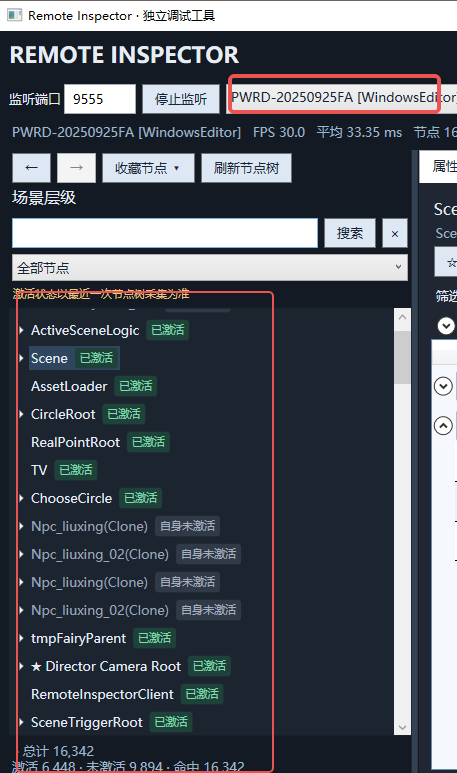

## 5. 属性查看和编辑

1. 支持工程中常见的枚举类型，通过弹出下拉框选择或复选。
2. 提供类似 Unity Inspector 的属性查看方式。
3. 支持编辑数值和向量；修改后点击“应用”，实时生效。
4. 支持查看纹理并导出到本地，**仅支持可读写纹理**。
5. 支持复制节点路径。
6. 支持手动刷新同步。
7. 支持全部展开，方便查找。
8. 支持全部折叠。
9. 提供快捷编辑及原始数据查看，便于快速校对属性名称和属性值。
10. 支持查看材质 Shader、材质属性、材质纹理及变体等。
11. 支持新增收藏节点，方便下次快捷查找。
12. 支持定位节点，减少滚动节点列表查找的操作。

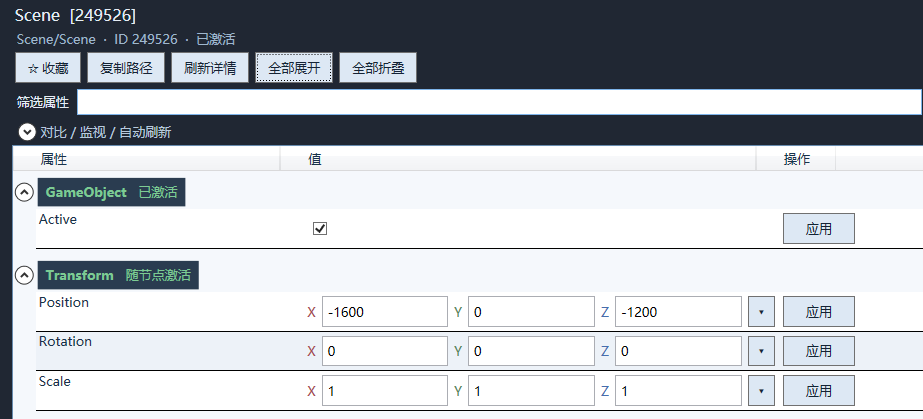

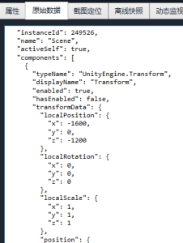

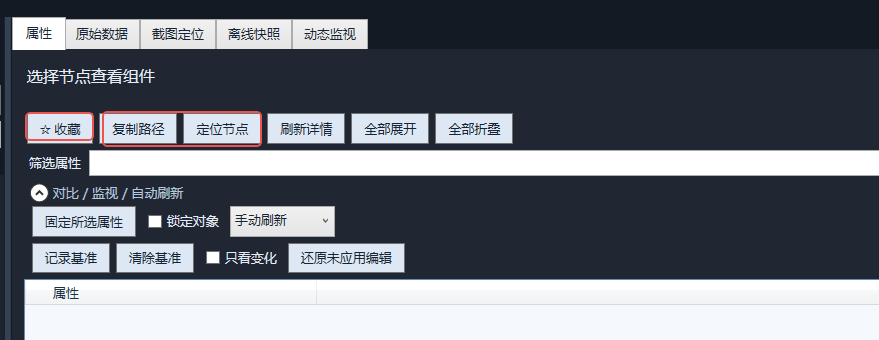

## 6. 截图定位功能

1. 抓取远程游戏画面。
2. 开启点击截图定位节点的功能。
3. 点击截图中的图片或按钮，左侧显示所有命中（hit）对象，结果可能有多个。
4. 点击查找结果，快速定位 UI 节点。

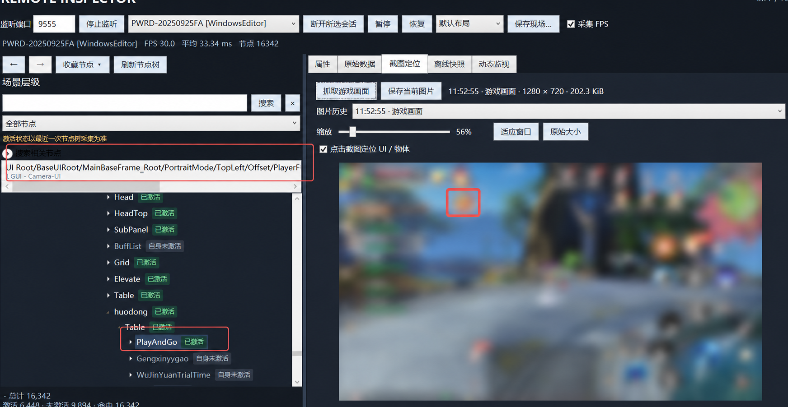

## 7. 动态监视

1. 选择场景节点，右键“加入监听”或“移除监听”。
2. 监听对象的属性、组件变化会显示在列表中，方便追踪。

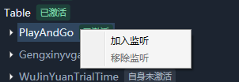

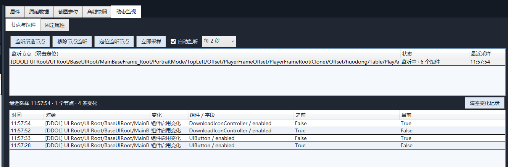

## 8. 离线快照

保存场景树、节点属性及日志快照，使用二进制格式存储。

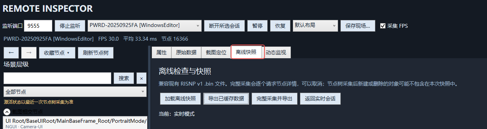

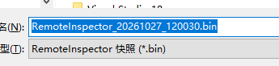

## 9. 日志查看

实时查看并过滤日志。

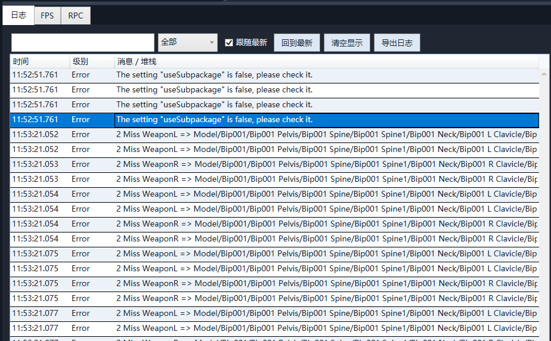

## 10. RPC 远程调用

1. 支持内置热更加载，方便调试热更代码。
2. 支持存储常用函数调用，封装常用函数列表。

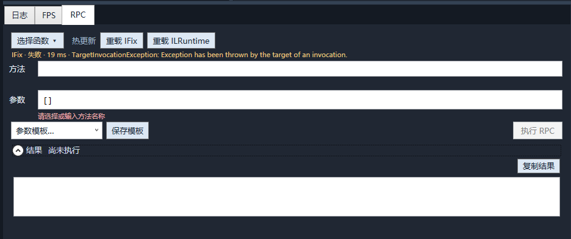

## 11. 远程文件管理

支持文件上传和下载。

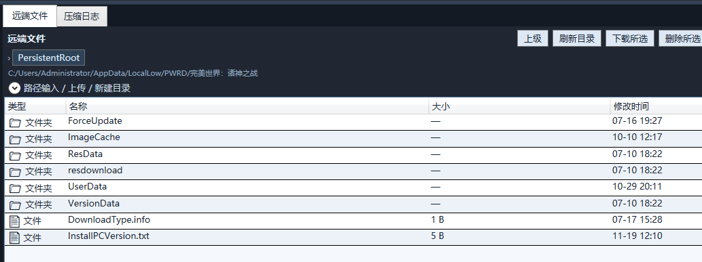

## 12. 压缩日志

支持双击查看远端压缩日志文件。

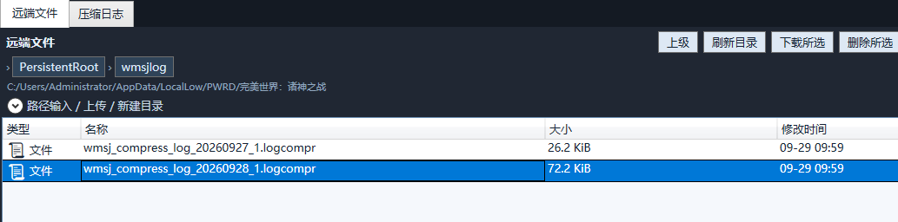

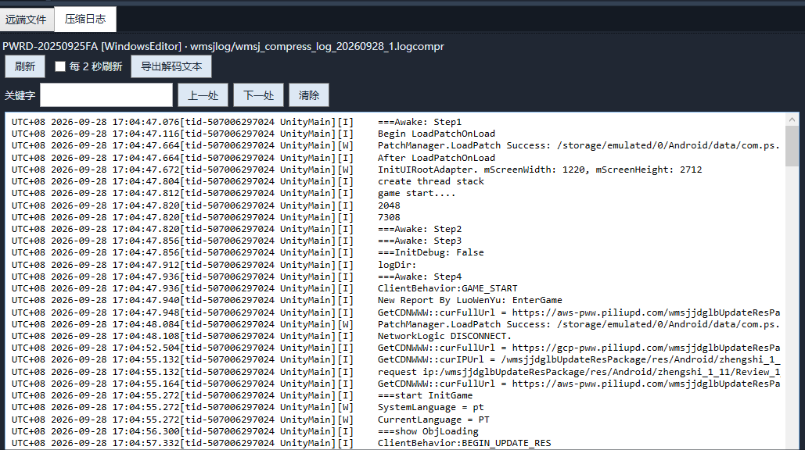

## 13. 布局切换

提供以下布局：

- 默认布局
- 对象排查
- 日志排查
- 性能观察

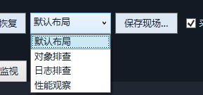

### 对象排查


### 日志排查

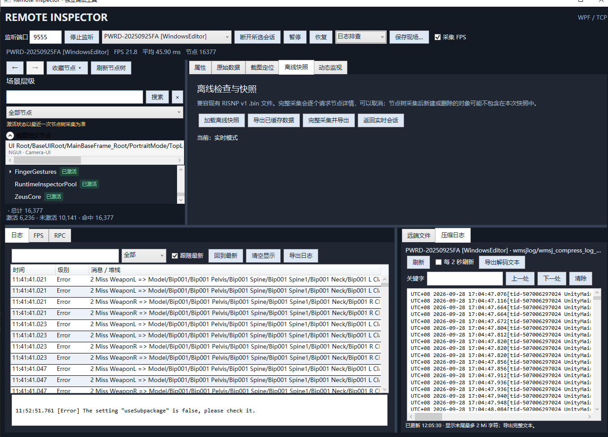

### 性能观察

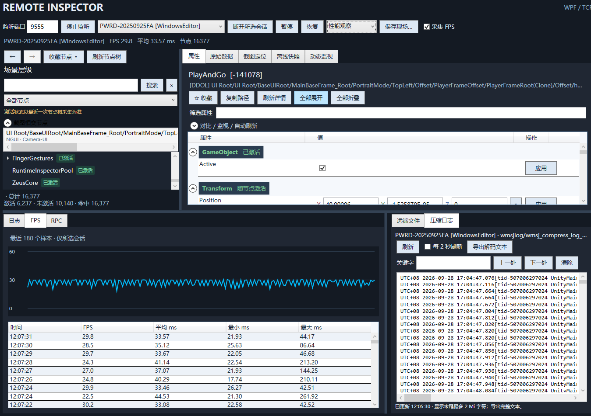

## 14. 后续扩展

原文标注：性能分析、卡顿日志收集即将上线。此处保留 PDF 导出时的说明，实际支持情况以当前工具版本为准。


## ⚙️ 核心设计决策

### 1. TCP协议（8字节固定包头）
```
[4字节 int32 总长度][2字节 ushort 命令ID][2字节 ushort 序列号][JSON包体]
```
- 支持粘包/拆包自动处理
- 心跳：每5秒一次，超时15秒断开
- 序列号用于匹配请求/响应

### 2. 纹理缓存机制
- 客户端维护已发送纹理的 `HashSet<int>`
- 编辑器请求纹理时，客户端检查缓存，已发送过则回复 `cached=true`（不传数据）
- 首次传输：JPG压缩(quality=60) → Base64 → 分块(32KB/块)传输
- 编辑器端缓存 `Dictionary<int, Texture2D>`，避免重复显示

### 3. 节点树同步
- 客户端启动时发送完整树（`NODE_TREE_RESPONSE`）
- 编辑器按需请求单个节点详情（`GET_NODE_DETAIL`）
- 节点标识：GameObject InstanceID

### 4. 组件数据采集
- Transform：本地+世界空间双套数据
- 材质：Shader名、所有Shader属性、纹理引用
- 其他组件：通过反射读取 `[SerializeField]` 和 `public` 字段

### 5. 暂停/恢复
- `PAUSE_CLIENT` → `Time.timeScale = 0`
- `RESUME_CLIENT` → `Time.timeScale = 1`
- 同时暂停数据采集循环，节省性能

### 6. 客户端命令控制台
- 默认隐藏，按 `` ` `` 或 `F12` 打开
- 命令：`/connect` `/disconnect` `/pause` `/resume` `/status` `/help` `/clear`

### 7. 文件上传
- 分块上传：64KB/块
- 路径：`Application.persistentDataPath` 下相对路径
- 重载回调：`FileReloadExtension.OnFileReceived` 事件，用户可自定义热重载逻辑

## 🔧 使用方法

### 编辑器端
1. 将 `Editor\` 目录放入 Unity 项目
2. 打开菜单：**Window → Remote Inspector**
3. 启动游戏（Play Mode）→ 服务器自动启动（端口9555）
4. 等待客户端连接，查看节点树、FPS、属性

### 客户端（Runtime）
1. 将 `Runtime\` 目录放入游戏项目
2. 在场景中创建空GameObject，挂载 `RemoteInspectorClient` 组件
3. 配置 IP 和端口（默认 `127.0.0.1:9555`）
4. 可选：挂载 `CommandConsole` 组件（`` ` `` 打开命令行）
5. 打包游戏 → 运行 → 输入 `/connect <编辑器IP> <端口>`

### 数据更新频率
- **每帧**：每帧采集FPS，每帧采集节点树（流量大）
- **每秒**：每秒采集一次，FPS按秒汇总（推荐）
- **每5秒**：适合远程排查
- **手动**：手动刷新

## 📋 命令列表

| 命令 | ID | 说明 |
|------|-----|------|
| HEARTBEAT | 0x0001 | 心跳保活 |
| GET_NODE_TREE | 0x0010 | 获取节点树 |
| NODE_TREE_RESPONSE | 0x0011 | 节点树响应 |
| GET_NODE_DETAIL | 0x0012 | 获取节点详情 |
| NODE_DETAIL_RESPONSE | 0x0013 | 节点详情响应 |
| PAUSE_CLIENT | 0x0020 | 暂停游戏 |
| RESUME_CLIENT | 0x0021 | 恢复游戏 |
| GET_FRAME_STATS | 0x0030 | 请求FPS数据 |
| FRAME_STATS_RESPONSE | 0x0031 | FPS数据响应 |
| FILE_UPLOAD_START | 0x0040 | 开始上传 |
| FILE_UPLOAD_CHUNK | 0x0041 | 上传数据块 |
| FILE_UPLOAD_END | 0x0042 | 上传完成 |
| FILE_UPLOAD_ACK | 0x0043 | 上传确认 |
| GET_TEXTURE | 0x0050 | 请求纹理 |
| TEXTURE_RESPONSE | 0x0051 | 纹理数据响应 |

## ⚠️ 注意事项

1. **IL2CPP兼容**：所有反射部分使用 `[Preserve]` 标记，避免代码剥离
2. **平台支持**：PC/Android/iOS/HM 全平台 TCP 通用
3. **多客户端**：支持同时连接多个游戏客户端，编辑器可查看不同连接的状态
4. **性能**：反射采集仅在用户请求节点详情时触发，不会持续影响游戏性能
5. **安全性**：仅用于开发调试，**不要**打包到正式发布版本中
