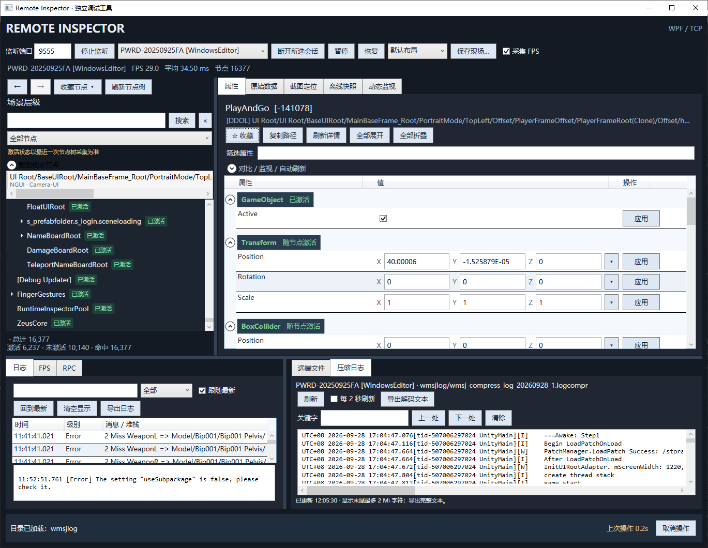

# RemoteInspector | Unity 远程调试与运行时 Inspector

通过独立的 Windows 桌面工具，远程查看 Unity 游戏的场景层级、编辑组件和材质属性、定位 UI 节点、查看日志及 FPS，并保存离线快照。桌面端无需安装 Unity Editor。

**Remote Inspector for Unity games.** A standalone Windows WPF desktop tool for remote runtime inspection, scene hierarchy browsing, component and material editing, screenshot-based UI picking, logs, FPS monitoring, and offline snapshots.

[图文使用说明](Editor.md) · [桌面端构建与配置](Editor_WPF/README.md) · [Unity Runtime 接入说明](UnityRuntime/README.md) · [验证记录](Editor_WPF/VALIDATION.md)



## 适合解决什么问题

- **运行中的游戏对象难查找**：按名称、路径或组件搜索场景节点，查看激活状态，收藏常用节点。
- **需要在设备上核对或调整属性**：查看组件、Transform、材质和 Shader 属性，修改受支持的字段并应用到游戏。
- **UI 位置可见，但不知道对应节点**：抓取游戏截图，点击画面查找命中的 UI 或物体。
- **需要追踪运行时变化**：查看日志、动态监视对象变化，观察 FPS 和帧耗时。
- **问题现场需要留存**：保存场景树、节点属性和日志快照，离线打开排查。

## 功能概览

| 功能 | 说明 |
| --- | --- |
| 场景层级与搜索 | 节点树、名称/路径/组件搜索、激活状态筛选、收藏与定位 |
| 运行时 Inspector | 组件属性、枚举、向量、颜色及支持字段的实时编辑 |
| 材质与纹理 | Shader 属性、材质槽、关键词、纹理预览与 PNG 导出；受 Runtime 可读能力限制 |
| 截图定位 | 远程抓图、图片保存、点击截图拾取 UI/物体 |
| 日志与监视 | 实时日志过滤、内容与堆栈查看、对象变化追踪 |
| 性能观察 | FPS 趋势和帧耗时查看 |
| 离线快照 | 保存与加载 `.bin` 快照，离线查看已采集数据 |
| RPC 与文件 | 注册函数调用、热更调用入口、远程文件上传和下载 |
| 多会话与布局 | 切换游戏连接，按对象、日志或性能排查场景切换布局 |

## 快速开始

### 1. 获取桌面工具

已有 Windows x64 便携包时，复制**整个发布文件夹**并运行 `RemoteInspector.exe`。自包含发布已包含 .NET 运行时。

从源码构建需要 **Windows + .NET 10 SDK**；具体 SDK 版本见 [global.json](Editor_WPF/global.json)。在仓库根目录执行：

```powershell
cd Editor_WPF
.\scripts\Build.ps1
```

脚本完成构建、验证和自包含发布后，运行：

```text
Editor_WPF/artifacts/portable-win-x64/RemoteInspector.exe
```

更多构建方式和配置见[桌面端说明](Editor_WPF/README.md)。

### 2. 接入 Unity 游戏端

将 `UnityRuntime/Runtime` 和 `UnityRuntime/Shared` 接入 Unity 项目，在场景对象上挂载 `RemoteInspectorClient`。需要命令控制台时，可挂载 `CommandConsole`。

桌面工具负责监听，游戏端主动连接。详细目录和接入方式见 [Runtime 文档](UnityRuntime/README.md)。

### 3. 连接并查看

1. 打开桌面工具，点击“启动监听”，默认端口为 `9555`。
2. 在游戏端命令控制台执行 `/connect <桌面工具所在电脑IP> 9555`；同机连接可使用 `127.0.0.1`。跨设备连接需确保网络可达且端口允许访问。
3. 连接成功后选择会话，查看场景节点树；点击节点查看属性，修改支持的字段后点击“应用”。
4. 如已有 `.bin` 快照，可直接离线加载查看。

项目定制的 GM 按钮和聊天命令接入示例见[图文说明](Editor.md)，具体入口取决于游戏项目的集成方式。

## 文档导航

| 想做什么 | 从这里开始 |
| --- | --- |
| 看界面、了解操作步骤 | [编辑器图文使用说明](Editor.md) |
| 构建桌面程序、配置枚举和 Layer 字典 | [桌面端说明](Editor_WPF/README.md) |
| 将调试客户端接入 Unity 游戏 | [Unity Runtime 说明](UnityRuntime/README.md) |
| 查看自动验证和联调边界 | [验证记录](Editor_WPF/VALIDATION.md) |
| 阅读桌面端源码 | [WPF 界面与 .NET 核心](Editor_WPF/src/) |
| 阅读游戏端源码与协议 | [Runtime](UnityRuntime/Runtime/) / [Shared](UnityRuntime/Shared/) |

## 项目结构

```text
RemoteInspector/
├── README.md                 # 项目首页与快速开始
├── Editor.md                 # 图文使用说明
├── docs/images/editor/       # 文档截图
├── Editor_WPF/               # 独立 Windows 桌面工具
│   ├── RemoteInspector.sln
│   ├── src/                  # WPF 界面与 .NET 核心
│   ├── config/               # 枚举与 Layer 配置
│   ├── scripts/Build.ps1     # 构建、验证和发布
│   └── tests/                # 协议与交互验证
└── UnityRuntime/             # Unity 游戏端接入代码
    ├── Runtime/              # 客户端、采集器与命令处理
    └── Shared/               # 协议和共享数据结构
```

## 兼容范围

桌面端使用 Windows WPF，核心为 .NET；游戏端通过 TCP 与其通信。可编辑字段、纹理读取、RPC 和文件操作取决于接入的 Runtime 版本与能力，具体边界见[桌面端兼容说明](Editor_WPF/README.md#兼容范围与边界)。

工具面向开发调试，当前使用明文 TCP 协议；请在受信任的开发网络中使用。

## 搜索关键词

Unity 远程调试、Unity 运行时 Inspector、真机调试、场景树、组件属性编辑、材质调试、UI 节点定位、日志查看、离线快照。

Unity remote debugger, remote inspector, runtime inspector, scene hierarchy, GameObject inspection, material inspector, UI picking, WPF, C#, .NET.
